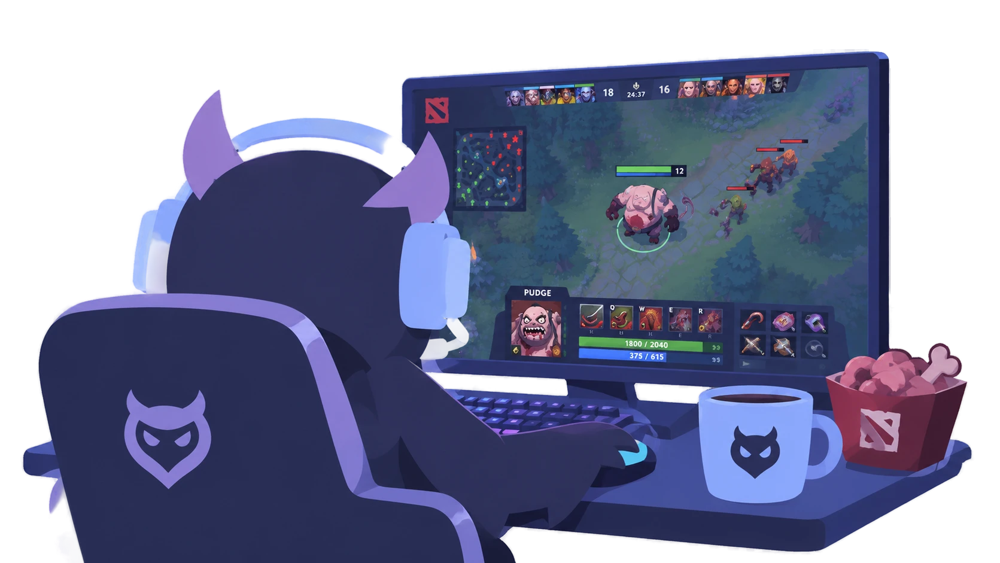

<p align="center">
  
</p>

<h1 align="center">Wisetalk</h1>

<p align="center">
  Voice and video chat for one community, on a server you control.<br>
  Linux · Windows · macOS · Android<br>
  End-to-end encrypted · Relayed by the server, never peer to peer · Open source
</p>

<p align="center">
  <b>English</b> &nbsp;|&nbsp; <a href="README.ru.md">Русский</a>
</p>

<p align="center">
  <a href="https://github.com/WiselessGroup/Wisetalk/releases/latest"></a>
  <a href="https://github.com/WiselessGroup/Wisetalk/releases"></a>
  <a href="https://github.com/WiselessGroup/Wisetalk/actions/workflows/build.yml"></a>
  <a href="https://github.com/WiselessGroup/Wisetalk/commits/master"></a>
  <a href="https://github.com/WiselessGroup/Wisetalk/stargazers"></a>
  <a href="LICENSE"></a>
</p>

<p align="center">
  
</p>

We were on TeamSpeak 6, and its peer-to-peer video kept dying on symmetric NATs. So the Wiseless crew wrote a replacement and has talked on it every day since.

One server is one community: no guilds, no workspaces, nothing to join or discover. Voice channels sit in spaces, every channel has a short-lived chat, and people share cameras and screens. Everything goes through the server's own relay, TURN on port 443 included, so it works on networks where peer-to-peer gives up. Calls and chats are end-to-end encrypted, and the server stores ciphertext and relays keys it can't open.

This is the native app, the one where audio and video get as good as the machine allows. There's also a [web client](https://git.wiseless.net/Wisetalk/webclient) that needs no install, and the two sit in the same calls. You need a [server](https://git.wiseless.net/Wisetalk/server) to connect to: your community's, or your own.

## Download

Files are on the [latest release](https://github.com/WiselessGroup/Wisetalk/releases/latest), and their names carry the version.

| System | File |
|---|---|
| Linux, x86_64 | `Wisetalk-X.Y.Z-x86_64.AppImage` |
| Windows 10 / 11, x64 | `Wisetalk-X.Y.Z-x64-Setup.exe` |
| macOS, Apple silicon | `Wisetalk-X.Y.Z-arm64.dmg` |
| Android 11+ | `Wisetalk-X.Y.Z.apk` |

iOS comes later.

On a desktop the app downloads updates in the background, and "Restart to Update" applies them (the next start does it anyway). On Android it tells you when there's a new APK. The interface speaks English, Russian, Traditional Chinese, Japanese, Brazilian Portuguese, German, French and Spanish.

### First start

- **Linux.** Make the AppImage executable and run it, or give it to [Gear Lever](https://flathub.org/apps/it.mijorus.gearlever), which makes one working icon and picks up new versions by itself.
- **Windows.** The installer isn't signed yet, so SmartScreen will warn you: "More info", then "Run anyway".
- **macOS.** Drag Wisetalk to Applications. It isn't notarized, so macOS blocks the first launch; allow it in System Settings → Privacy & Security → "Open Anyway".
- **Android.** Let your browser install the APK. Summons reach you with the app closed if you leave Stay Connected on, and it asks once to be left out of battery optimization.

Then type your server's address and sign in through your browser, or as a guest with just a name if the server allows it.

## What it does

- Calls with camera and screen sharing, with a fresh key for every call. On Windows a shared window brings its app's sound along. On Linux and Windows a microphone goes out in stereo when voice processing is off.
- Channel chats with pictures, and notifications for summons and messages. On Android a foreground service keeps calls alive, and summons arrive with the app closed, without Google or a push app.
- Several servers one click apart. `wisetalk://` links from a server's page add one or open it.
- Away, which turns your microphone and everyone's sound off with one click. Others see a crossed-out headphone, and a sleepy owl hoots.
- Connection bars with ping and loss, so you can tell whose network it is.
- Ctrl+Shift+M and Ctrl+Shift+A (⌘ on a Mac) while the window is in front, and global hotkeys on Windows, macOS and X11.
- Guest passports: a guest the server knows and never kicked isn't held back by the limits of a shared address.
- Moderation and everyday admin: mutes, kicks, bans, owners, channel and space settings, creating and reordering. Whitelists, per-role permissions and setting channel icons stay in the web client, which gets every admin feature first.
- Settings for devices, voice processing, sounds, summons and notifications. Phones get a one-column layout and full-screen sheets.
- Costs next to nothing while nobody is talking. A minimized window on Wayland stops drawing altogether.

Release by release, it's all in [CHANGELOG.md](CHANGELOG.md).

## Questions

**Does it come with a server?** No. Wisetalk is one community on one server, so someone has to run it. The [server](https://git.wiseless.net/Wisetalk/server) has a self-hosting kit with Docker Compose.

**Can the server listen to my calls?** It carries the media but doesn't have the keys. Calls are encrypted on your device with a key the participants share among themselves. Chats are the same, and pictures are encrypted like the text.

**Will it work behind my network?** That's the reason it exists. Nothing is peer to peer: media goes to the server's relay, with TURN over TLS on port 443 for networks that block the rest.

**What does the app connect to on its own?** Here's the whole list:

- the servers you added, and their media relays;
- GitHub, for updates on the desktop (Android asks your server instead);
- our crash reporter, only if you turned crash reports on. They never carry messages, names, keys or servers.

**Is there a web version?** Yes, an installable PWA at your server's address. It has the fullest administration; audio and video go furthest in the app.

## How it's built

```
lib/                the Flutter app; lib/theme.dart holds the design tokens
lib/src/rust/       Dart side of the bridge, generated, don't edit
rust/               wisetalk_bridge: device keys, call and chat encryption,
                    proof of work, name checks, all from core
hook/build.dart     compiles rust/ during flutter build and bundles the library
android/ linux/
macos/ windows/     platform runners
packaging/linux/    the AppImage's desktop entry, metainfo and AppRun
scripts/            checks, measuring, the package builds
```

One Flutter codebase for every platform. Nothing in Dart encrypts anything: all the crypto comes from [core](https://git.wiseless.net/Wisetalk/core) through flutter_rust_bridge, the same library the web client compiles to WebAssembly. Media goes through [LiveKit](https://livekit.io).

## Building from source

You need Flutter 3.47, `rustup` (`rust/rust-toolchain.toml` pins the version and targets), and `cargo install flutter_rust_bridge_codegen --version 2.13.0 --locked`.

- **Linux on Fedora:** `clang cmake ninja-build pkgconf-pkg-config gtk3-devel libstdc++-devel mesa-libGLU libsecret-devel libayatana-appindicator-gtk3-devel pulseaudio-libs-devel`.
- **macOS:** Xcode.
- **Windows:** Visual Studio 2022 with "Desktop development with C++".
- **Android:** Android Studio, SDK API 36, NDK, cmdline-tools.

`flutter doctor -v` tells you what's still missing.

```bash
flutter run -d linux                    # or macos, windows; build hooks compile the bridge too
flutter test                            # widget tests load rust/target/release
cd rust && cargo test                   # the bridge on its own
flutter_rust_bridge_codegen generate    # after changing rust/src/api
scripts/check.sh                        # everything that has to pass before a push
```

The bridge library is looked up in `rust/target/release` relative to the working directory before the bundled copy. A stale build there wins over the fresh one in the app; `cargo build --release` in `rust/` fixes that. On a Mac the widget test that loads the bridge and the D-Bus notification tests fail, so `flutter test` and `scripts/check.sh` are meant for Linux.

How releases are made is in [docs/releasing.md](docs/releasing.md).

## Contributing

Bug reports help the most, especially about networks we can't test from. Open them in [GitHub issues](https://github.com/WiselessGroup/Wisetalk/issues).

This GitHub repository is a mirror of the one we work in, [git.wiseless.net/Wisetalk/client](https://git.wiseless.net/Wisetalk/client), so pull requests are applied there with your name on the commits, and come back here through the mirror.

If Wisetalk got your friends off a call that kept dropping, a star helps other people find it.

## License

[AGPL-3.0](LICENSE). If you run a modified version for others, you have to offer them its source code. [core](https://git.wiseless.net/Wisetalk/core) is MIT or Apache-2.0, so you can write your own client.
